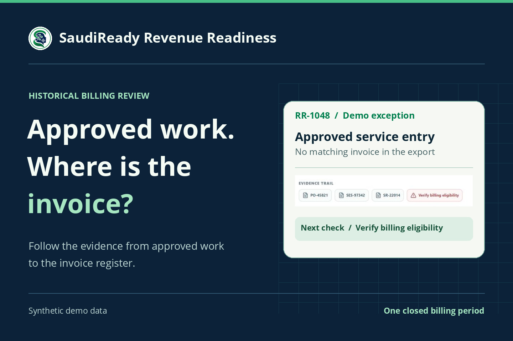

# SaudiReady Revenue Readiness

**Explore how invoice-readiness workflows could look before building the backend.**

## Current scope

SaudiReady Revenue Readiness is a frontend demonstration using synthetic records. A private English React/TypeScript template is undergoing release checks. **The template is not yet offered for purchase.**

The interface illustrates an overview dashboard, exception details, readiness views, accounting-control explanations, persona navigation and a hypothetical impact simulator. It does not process real billing evidence or detect exceptions from uploaded records.

## Included versus proposed

| Available in the demonstration | Not implemented or not included |
| --- | --- |
| Synthetic example records and interactive screens | Real document uploads or processing |
| Illustrative readiness and accounting explanations | Accounting, tax or compliance decisions |
| Hypothetical impact calculations | Guaranteed savings or recovered revenue |
| Frontend navigation and example details | Authentication, database or ERP integration |
| Explanatory future-feature panels | Payments, alerts, evidence-pack exports or production workflows |

Purchasing a future template would not unlock the proposed features. Any professional review service would require a separate written scope; it is not included in the template.

## Preview

[Open the interactive demonstration](https://saudiready-revenue-readiness-demo-4b6ip2.v2.appdeploy.ai/)

The deployed demonstration may differ from the private English candidate. The cover, [walkthrough](assets/walkthrough.mp4) and [overview PDF](assets/buyer-overview.pdf) are earlier concept/service materials, not a specification of software deliverables or a purchase offer. Do not upload confidential records or include confidential data in shared URLs.

## Release checks

The private English candidate passed TypeScript checks, a production build, nine component server-render checks and safe-share URL regressions for three personas. The latest private update adds labelled native dialogs, long-dialog scrolling, reduced-motion support and a sanitized manual share-link fallback. These changes have not yet replaced the deployed demonstration. Real-browser/mobile acceptance, final license, support terms and buyer delivery verification remain open. These checks do not establish production readiness.

This repository is public preview material only. Paid source packages are kept outside the public repository.

Contact: [saudiready.ai@gmail.com](mailto:saudiready.ai@gmail.com)
